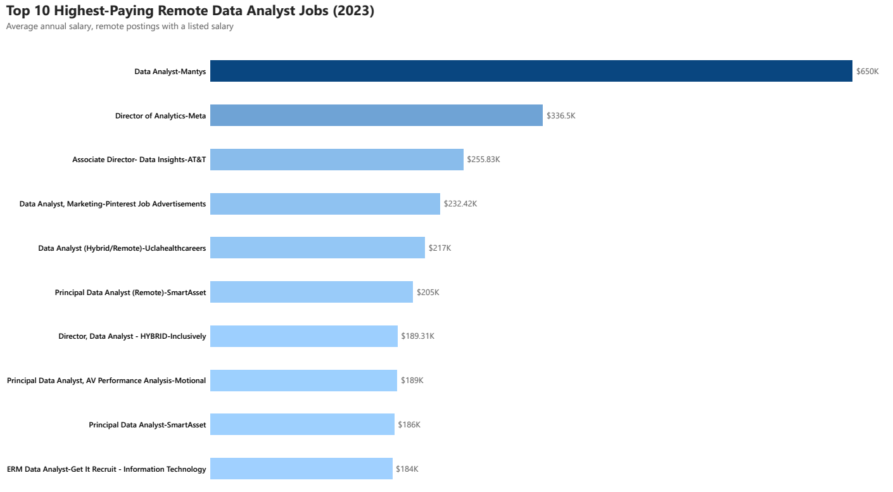
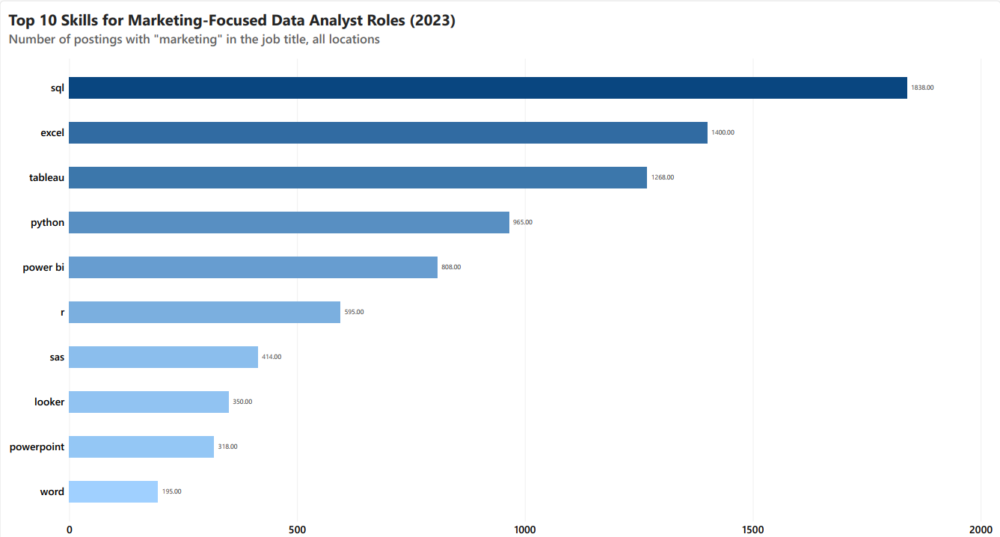

# Introduction
Dive into the data job market! Focusing on data analyst roles, this project explores top-paying jobs, in-demand skills, and where high demand meets high salary in data analytics.

SQL queries? Check them out here: [Project_sql folder](/Project_sql/)

# Background
Driven by a quest to navigate the data analyst job market more effectively, this project was born from a desire to pinpoint top-paid and in-demand skills, streamlining others work to find optimal jobs.

### The questions I wanted to answer through my SQL queries were:
1. What are the top-paying data analyst jobs?
2. What skills are required for these top-paying jobs?
3. What skills are most in demand for data analysts?
4. Which skills are associated with higher salaries
5. What are the most optimal skills to learn?
6. What skills do marketing-focused data analyst roles require, and how do they pay?

# Tools I used
For my deep dive into the data analyst job market, I harnessed the power of several key tools:

- **SQL**: The backbone of my analysis, allowing me to query the database and unearth critical insights.
- **PostgreSQL**: The chosen database management system, ideal for handling the job posting data.
- **Visual Studio Code**: My go-to for database management and executing SQL queries.
- **Git & Github**: Essential for version control and sharing my SQL scripts and analysis, ensuring collaboration and project tracking.
- **Power BI**: Used to visualize query results, turning top-paying jobs and in-demand skills into clear bar charts.

# The Analysis
Each query for this project aimed at investigating specific aspects of the data analyst job market.
Here's how I approached each question

### 1. Top paying Data Analyst
To identify the highest-paying roles, I filtered data analyst positions by average yearly salary and location, focusing on remote jobs. This query highlights the high paying opportunities in the field.

```sql
SELECT
    job_id,
    job_title,
    job_location,
    job_schedule_type,
    salary_year_avg,
    job_posted_date,
    name AS company_name
FROM 
    job_postings_fact
LEFT JOIN
     company_dim ON job_postings_fact.company_id = company_dim.company_id
WHERE  
    job_title_short = 'Data Analyst' AND
    job_location = 'Anywhere' AND
    salary_year_avg IS NOT NULL
ORDER BY
    salary_year_avg DESC
LIMIT 10
```
Here's the breakdown of the top data analyst jobs in 2023:
- **Wide Salary Range**: Top 10 paying data analyst roles span from $184,000 to $650,000, indicating significant salary potential in the field.
- **Diverse Employer**: Companies like SmartAssest, Meta, and AT&T are among those offering high salaries, showing a broad interest accross different industries.
- **Job Titles Variety**: There's a high diversity in job titles, from Data Analyst to Director of Analytics, reflecting varied roles and specializations within data analytics.


*Bar graph visualizing the salary for the top 10 salaries for data analysts; Using Power BI to generate this graph from my SQL query results*

### 2. Skills for Top Paying Jobs
To understand what skills are required for the top-paying jobs, I joined the job postings with the skills data, providing insights into what employers value for high-compensation roles.

``` sql
WITH top_paying_jobs AS (
    SELECT
        job_id,
        job_title,
        salary_year_avg,
        name AS company_name
    FROM 
        job_postings_fact
    LEFT JOIN
        company_dim ON job_postings_fact.company_id = company_dim.company_id
    WHERE  
        job_title_short = 'Data Analyst' AND
        job_location = 'Anywhere' AND
        salary_year_avg IS NOT NULL
    ORDER BY
        salary_year_avg DESC
    LIMIT 10)

SELECT 
    top_paying_jobs.*,
    skills
FROM top_paying_jobs
INNER JOIN skills_job_dim ON top_paying_jobs.job_id = skills_job_dim.job_id
INNER JOIN skills_dim ON skills_job_dim.skill_id = skills_dim.skill_id
ORDER BY
    salary_year_avg DESC
```
Here is the breakdown of the most demanded skills for the top 10 highest paying data analyst jobs in 2023:
- **SQL** is leading with a bold count of 8
- **Python** follows closely with a bold count of 7
- **Tableau** is also highly sought after, with a bold count of 6. Other skills like **R**, **Snowflake**, **Pandas**, and **Excel** show varying degrees of demand.


*Bar graph visualizing the count of skills for the top 10 paying jobs for data analysts; Ussing Power BI to generate this graph from my SQL query results*

### 3. In-Demand Skills for Data Analysts
This query helped identify the skills most frequently requested in job postings, directing focus to areas with high demand.

```sql
SELECT
    skills,
    COUNT(skills_job_dim.job_id) AS demand_count
FROM job_postings_fact
INNER JOIN skills_job_dim ON job_postings_fact.job_id = skills_job_dim.job_id
INNER JOIN skills_dim ON skills_job_dim.skill_id = skills_dim.skill_id
WHERE
    job_title_short = 'Data Analyst' AND
    job_work_from_home = True
GROUP BY
    skills
ORDER BY
    demand_count DESC
LIMIT 5
```
Here's the breakdown of the most demanded skills for the data analysts in 2023
- **SQL** and **Excel** remain fundamental, emphasizing the need for strong foundational skills in data processing and spreadsheet manipulations.
- **Programming** and **Visualization** like **Python**, **Tableau**, **Power BI** are essential, poiting towards the increasing importance of technical skills in data storytelling and decision support.

| Skills   | Demand Count |
|----------|--------------|
| SQL      | 7,291        |
| Excel    | 4,611        |
| Python   | 4,330        |
| Tableau  | 3,745        |
| Power BI | 2,609        |

*Table of the demand for the top 5 skills in data analyst job postings*

### 4. Skills Based on Salary
Exploring the average salaries associated with different skills revealed which skills are the highest paying.

```sql
SELECT
    skills,
    ROUND(AVG(salary_year_avg), 0) AS avg_salary
FROM job_postings_fact
INNER JOIN skills_job_dim ON job_postings_fact.job_id = skills_job_dim.job_id
INNER JOIN skills_dim ON skills_job_dim.skill_id = skills_dim.skill_id
WHERE
    job_title_short = 'Data Analyst' AND
    salary_year_avg IS NOT NULL AND
    job_work_from_home = True
GROUP BY
    skills
ORDER BY
    avg_salary DESC
LIMIT 25
```
Here's the breakdown of the result for top paying skills for Data Analysts:
- **High Demand for Big Data & ML Skills**: Top salaries are commanded by analysts skilled in big data technologies (PySpark, Couchbase), machine learning tools (DataRobot, Jupyter), and Python libraries (Pandas, NumPy), reflecting the industry's high valuation of data processing and predictive modeling capabilities.
- **Software Development & Deployment Proficiency**: Knowledge in development and deployment tools (GitLab, Kubernetes, Airflow) indicates a lucrative crossover between data analysis and engineering, with a premium on skills that facilitate the automation and efficient data pipeline managment.
- **Cloud Computing Expertise**: Familiarity with cloud and data engineering tools (Elasticsearch, Databricks, GCP) underscores the growing importance of cloud-based analytics environments, suggesting that cloud proficiency significantly boosts earning potential in data analytics.

| Skills        | Average Salary ($) |
|---------------|-------------------:|
| PySpark       | 208,172            |
| Bitbucket     | 189,155            |
| Couchbase     | 160,515            |
| Watson        | 160,515            |
| DataRobot     | 155,486            |
| GitLab        | 154,500            |
| Swift         | 153,750            |
| Jupyter       | 152,777            |
| Pandas        | 151,821            |
| Elasticsearch | 145,000            |
| Golang        | 145,000            |
| NumPy         | 143,513            |
| Databricks    | 141,907            |
| Linux         | 136,508            |
| Kubernetes    | 132,500            |
| Atlassian     | 131,162            |
| Twilio        | 127,000            |
| Airflow       | 126,103            |
| Scikit-learn  | 125,781            |
| Jenkins       | 125,436            |
| Notion        | 125,000            |
| Scala         | 124,903            |
| PostgreSQL    | 123,879            |
| GCP           | 122,500            |
| MicroStrategy | 121,619            |

*Table of the average salary for the top 25 paying skills for data analysts*

### 5. Most Optimal Skills to Learn
Combing insights from demand and salary data, this query aimed to pinpoint skills that are both in high demand and have high salaries, offering a strategic focus for skill development.

```sql
WITH skills_demand AS (
    SELECT
        skills_job_dim.skill_id,
        skills_dim.skills,
        COUNT(skills_job_dim.job_id) AS demand_count
    FROM job_postings_fact
    INNER JOIN skills_job_dim ON job_postings_fact.job_id = skills_job_dim.job_id
    INNER JOIN skills_dim ON skills_job_dim.skill_id = skills_dim.skill_id
    WHERE
        job_title_short = 'Data Analyst' AND
        salary_year_avg IS NOT NULL AND
        job_work_from_home = True
    GROUP BY
        skills_job_dim.skill_id, 
        skills_dim.skills
), average_salary AS (
    SELECT
    skills_job_dim.skill_id,
    ROUND(AVG(salary_year_avg), 0) AS avg_salary
    FROM job_postings_fact
    INNER JOIN skills_job_dim ON job_postings_fact.job_id = skills_job_dim.job_id
    WHERE
        job_title_short = 'Data Analyst' AND
        salary_year_avg IS NOT NULL AND
        job_work_from_home = True
    GROUP BY 
        skills_job_dim.skill_id 
)

SELECT
    skills_demand.skill_id,
    skills_demand.skills,
    demand_count,
    avg_salary
FROM 
    skills_demand
INNER JOIN average_salary ON skills_demand.skill_id = average_salary.skill_id
WHERE demand_count >10
ORDER BY
    demand_count DESC,
    avg_salary DESC 
LIMIT 25;
```
| Skill ID | Skills      | Demand Count | Average Salary ($) |
|---------:|-------------|-------------:|-------------------:|
| 0        | SQL         | 398          | 97,237             |
| 181      | Excel       | 256          | 87,288             |
| 1        | Python      | 236          | 101,397            |
| 182      | Tableau     | 230          | 99,288             |
| 5        | R           | 148          | 100,499            |
| 183      | Power BI    | 110          | 97,431             |
| 7        | SAS         | 63           | 98,902             |
| 186      | SAS         | 63           | 98,902             |
| 196      | PowerPoint  | 58           | 88,701             |
| 185      | Looker      | 49           | 103,795            |
| 188      | Word        | 48           | 82,576             |
| 80       | Snowflake   | 37           | 112,948            |
| 79       | Oracle      | 37           | 104,534            |
| 61       | SQL Server  | 35           | 97,786             |
| 74       | Azure       | 34           | 111,225            |
| 76       | AWS         | 32           | 108,317            |
| 192      | Sheets      | 32           | 86,088             |
| 215      | Flow        | 28           | 97,200             |
| 8        | Go          | 27           | 115,320            |
| 199      | SPSS        | 24           | 92,170             |
| 22       | VBA         | 24           | 88,783             |
| 97       | Hadoop      | 22           | 113,193            |
| 233      | Jira        | 20           | 104,918            |
| 9        | JavaScript  | 20           | 97,587             |
| 195      | SharePoint  | 18           | 81,634             |

*Table of the most optimal skills for data analysts, sorted by demand*

Here's a breakdown of the most optimal skills for Data Analysts in 2023:
- **High-Demand Programming Languages**: Python and R stand out for their high demand, with demand counts for 236 and 148 respectively. Despite their high demand, their average salaries are around $101,397 for Python and $100,499 for R, indicating that proficiency in these languages is highly valued but also widely available.
- **Cloud Tools and Technologies**: Skills in specialized technologies such as Snowflake, Azure, AWS, and Go show significant demand with relatively high average salaries, pointing towards the growing importance of cloud platforms and big data technologies in data analysis.
- **Business Intelligence and Visualization Tools**: Tableau and Looker, with demand counts of 230 and 49 respectively, and average salaries around $99,288 and $103,795, highlight the critical role of data visualization and business intelligence in deriving actionable insights from data.
- **Database Technologies**: The demand for skills in traditional and Oracle, SQL Server with average salaaries ranging from $97,786 to $104,534, reflects the enduring need for data storage, retrieval, and management expertise.

### 6. Marketing-Focused Data Analyst Roles
To connect this analysis to my interest in marketing, I filtered data analyst postings with "marketing" in the job title, comparing their salaries against other data analyst roles and identifying the skills these positions require.

```sql
SELECT
    CASE 
        WHEN job_title ILIKE '%marketing%' THEN 'Marketing'
        ELSE 'Other'
    END AS role_group,
    COUNT(*) AS postings,
    ROUND(AVG(salary_year_avg), 0) AS avg_salary
FROM
    job_postings_fact
WHERE
    job_title_short = 'Data Analyst' AND
    salary_year_avg IS NOT NULL
GROUP BY
    role_group;
```

| Role Group | Postings (with salary) | Average Salary ($) |
|------------|-----------------------:|-------------------:|
| Marketing  | 100                    | 97,340             |
| Other      | 5,363                  | 93,811             |

*Table comparing the average salary of marketing-focused data analyst roles with other data analyst roles*

```sql
SELECT
    skills_dim.skills,
    COUNT(skills_job_dim.job_id) AS demand_count,
    ROUND(AVG(job_postings_fact.salary_year_avg), 0) AS avg_salary
FROM job_postings_fact
INNER JOIN skills_job_dim ON job_postings_fact.job_id = skills_job_dim.job_id
INNER JOIN skills_dim ON skills_job_dim.skill_id = skills_dim.skill_id
WHERE
    job_postings_fact.job_title_short = 'Data Analyst' AND
    job_postings_fact.job_title ILIKE '%marketing%'
GROUP BY skills_dim.skills
ORDER BY demand_count DESC
LIMIT 10;
```
Here's the breakdown of marketing-focused data analyst roles in 2023:
- **Slightly Higher Pay**: Marketing-focused analysts average $97,340, about $3,500 more than other data analyst roles ($93,811), though this is based on a smaller sample of 100 postings with listed salaries.
- **Same Core Toolkit**: SQL, Excel, Tableau, Python, and Power BI remain the top five skills, showing that the foundation for marketing analysts is the same as for data analysts overall.
- **Reporting Takes Priority**: Tableau ranks above Python, and Looker makes the top 10 with the highest average salary ($105,223), reflecting a stronger focus on dashboards and performance reporting in marketing teams.
- **Communication Is Part of the Job**: PowerPoint appears in the top 10, highlighting the need to present insights to stakeholders, though it carries the lowest average salary ($76,500).


*Bar graph visualizing the top 10 skills for marketing-focused data analyst roles; Using Power BI to generate this graph from my SQL query results*

| Skills     | Demand Count | Average Salary ($) |
|------------|-------------:|-------------------:|
| SQL        | 1,838        | 99,922             |
| Excel      | 1,400        | 89,587             |
| Tableau    | 1,268        | 102,271            |
| Python     | 965          | 98,177             |
| Power BI   | 808          | 93,535             |
| R          | 595          | 103,567            |
| SAS        | 414          | 83,167             |
| Looker     | 350          | 105,223            |
| PowerPoint | 318          | 76,500             |
| Word       | 195          | 93,170             |

*Table of the demand and average salary for the top 10 skills in marketing-focused data analyst postings (all locations)*

# What I learned

Throughout this adventure, I've turbocharged my SQL toolkit with some serious firepower:

- **Complex Query Crafting**: Mastered the art of advanced SQL, merging tables like a pro and wielding WITH clauses for ninja-level temp table maneuvers.
- **Data Aggregation**: Got cozy with GROUP BY and tunred aggregate functions like COUNT() and AVG() into my data-summarizing sidekicks.
- **Analytical Widzardry**: Leveled up my real-world puzzle-solving skills, turning questions into actionable, insightful SQL queries.

# Conclusions

### Insights
From the analysis, several general insights emerged:

1. **Top-Paying Data Analyst Jobs**: The highest-paying remote data analyst jobs offer a wide range of salaries, from $184K up to $650K, with one standout posting at Mantys well above the rest.
2. **Skills for Top-Paying Jobs**: SQL appears in 8 of the 10 highest-paying jobs, followed by Python (7) and Tableau (6), suggesting SQL is a critical skill for earning a top salary.
3. **Most In-Demand Skills**: SQL is also the most demanded skill in the data analyst job market (7,291 postings), followed by Excel and Python, making it essential for job seekers.
4. **Skills with Higher Salaries**: Specialized skills such as PySpark ($208K) and Bitbucket ($189K) are associated with the highest average salaries, indicating a premium on big data and engineering expertise.
5. **Optimal Skills for Job Market Value**: SQL leads in demand (398 postings) with a solid average salary of $97K, making it the most essential skill to learn first. Cloud and big data tools like Snowflake, Azure, and AWS pay more ($108K+) and are worth adding next.
6.  **Marketing-Focused Analyst Roles**: Data analyst roles in marketing pay slightly more ($97K vs. $94K) and rely on the same core skills, with a stronger emphasis on reporting tools like Tableau and Looker.

### Closing Thoughts
This project sharpened my SQL skills, from multi-table joins to CTEs and aggregations, and gave me my first hands-on experience building visuals in Power BI.

The takeaway is clear: SQL is the foundation. It tops both overall demand and the skill lists of the highest-paying roles. From there, cloud and big data tools like Snowflake, Azure, and PySpark are where the salary premium starts.

For my own job search, this gives me a roadmap: strengthen SQL and Python first, build reporting skills in Tableau and Power BI for marketing-focused roles, then add one cloud platform to stand out.